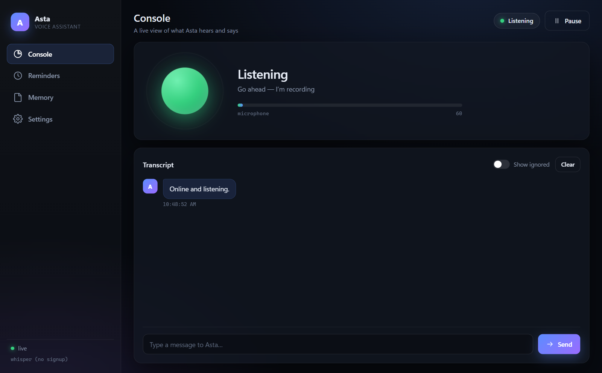

<div align="center">

# Asta

**An always-on, local-first voice assistant for Windows.**

Wake word in, spoken answer out — speech never leaves your machine.<br/>
Reasoning runs through [OpenCode](https://opencode.ai), which gives Asta real tools: files, shell, web, and your Obsidian vault.

[](LICENSE)
[](#requirements)
[](#requirements)
[](#privacy)



</div>

---

## Overview

Asta listens for its name, records until you stop talking, transcribes locally,
thinks with an OpenCode agent, and speaks the answer through local text-to-speech.
It also runs a live dashboard so you can see what it heard and said, manage
reminders and memories, and change settings without touching a config file.

Speech recognition and synthesis are fully on-device. Only the *reasoning* step
uses a model provider.

## Features

- **Hands-free wake word** — say _"Asta"_ and speak. No button, no hotkey.
- **100% local speech** — [whisper.cpp](https://github.com/ggerganov/whisper.cpp) for STT (CUDA-accelerated), [Piper](https://github.com/rhasspy/piper) for TTS.
- **Real tools** — the agent can read/write files, run shell commands, search the web, and query your Obsidian vault over MCP.
- **Live dashboard** — server-sent events push transcript, status and mic level to a local web app in real time.
- **Reminders & memory** — natural-language times ("in 20 minutes", "tomorrow 9am"), stored in your vault.
- **Self-echo suppression** — the mic is drained while Asta speaks, so it never transcribes itself.
- **Runs at logon** — optional hidden autostart via Task Scheduler.
- **Zero heavy UI dependencies** — plain HTML/CSS/JS served by the daemon, opened as a native-looking app window.

## Architecture

```mermaid
flowchart LR
    MIC([Microphone]) --> WAKE{Wake engine}
    WAKE -->|hears "Asta"| REC[Recorder<br/>silence endpointing]
    REC --> STT[whisper.cpp<br/>local STT · CUDA]
    STT --> BRAIN[OpenCode agent<br/>asta]
    BRAIN --> TTS[Piper<br/>local TTS]
    TTS --> SPK([Speakers])
    BRAIN --> TOOLS[Tools<br/>shell · files · web · MCP]
    TOOLS --> VAULT[(Obsidian vault)]
    TTS -.drain mic.-> MIC
```

The daemon (`src/asta.js`) owns a single turn queue, so overlapping speech,
reminder chimes and typed dashboard messages never race for the microphone.

## Requirements

| Requirement | Notes |
|---|---|
| **Windows 10/11** | Uses WASAPI, Task Scheduler and Windows SAPI as a fallback. |
| **Node.js ≥ 20** | ES modules, top-level `await`. |
| **OpenCode** | The desktop app or CLI; `opencode-cli.exe` is auto-detected. |
| **obsidian + Local REST API plugin** | Optional. Only needed for vault features. |
| **GPU** | Optional. whisper.cpp falls back to CPU. CUDA build included. |

## Installation

```powershell
git clone https://github.com/akashrameshbaburs-lab/asta.git
cd asta
npm install
npm run doctor          # verifies Node, audio devices, whisper, Piper, OpenCode
```

Download the local speech binaries and models (~2.4 GB, kept out of git):

```powershell
powershell -File scripts\download.ps1
powershell -File scripts\extract.ps1
```

## Usage

```powershell
npm start                    # run the assistant
npm run ui                   # start the daemon and open the dashboard
npm run talk                 # manual mode: press Enter to talk
npm run whisper              # hands-free wake word
npm run doctor               # environment check
```

One-off round trip, useful for testing:

```powershell
node src\asta.js --once "what is on my calendar"
node src\say.js "some words"
```

Reminders and memory from the CLI:

```powershell
node src\asta-cli.js remind "call mom" "in 20 minutes"
node src\asta-cli.js list
node src\asta-cli.js done 2
node src\asta-cli.js remember "I use the metric system"
node src\asta-cli.js recall "metric"
```

## Dashboard

`npm run ui` starts the daemon and opens `http://127.0.0.1:7373/` in an app-style
window. It is **loopback-only** and every request is checked against a
per-run token injected into the page, so other websites cannot drive your
assistant.

| Tab | What it does |
|---|---|
| **Console** | Live status, mic level, transcript, and a text box to talk to Asta without speaking. |
| **Reminders** | Add, complete and remove reminders. |
| **Memory** | Browse and search long-term memories. |
| **Settings** | Change wake mode, model, thresholds and UI options; writes are validated. |

## Configuration

All settings live in `config.json`.

| Key | Default | Description |
|---|---|---|
| `wake.mode` | `whisper` | `whisper`, `porcupine` or `manual`. |
| `wake.label` | `Asta` | Wake word spoken phrase. |
| `stt.language` | `en` | Whisper language hint. |
| `tts.engine` | `piper` | `piper` or `sapi`. |
| `audio.silenceThreshold` | `500` | Energy level that counts as silence. |
| `audio.silenceMs` | `1100` | Silence length that ends an utterance. |
| `brain.model` | `opencode/beam-free` | Model used by the agent. |
| `brain.agent` | `asta` | OpenCode agent name. |
| `vault.path` | — | Obsidian vault root. |
| `reminders.pollSeconds` | `20` | How often reminders are checked. |
| `ui.port` | `7373` | Dashboard port. |
| `ui.openOnStart` | `true` | Open the app window when the daemon starts. |

Binary paths under `paths` are auto-detected on each start and cannot be
overwritten from the dashboard.

### Wake modes

| Mode | Trade-off |
|---|---|
| `whisper` | Default. No account or signup. Costs GPU time on any speech in the room. |
| `porcupine` | Best accuracy, very low CPU. Needs a free Picovoice AccessKey and an `Asta.ppn`. |
| `manual` | Press Enter to talk. Good for quiet rooms and testing. |

If `porcupine` is selected but unconfigured, Asta warns and falls back to `manual`
instead of failing to start.

## Autostart

```powershell
powershell -File scripts\install-autostart.ps1     # start hidden at logon
powershell -File scripts\uninstall-autostart.ps1   # remove and stop
```

This registers a Task Scheduler job named **Asta Voice Assistant** that runs
`wscript.exe` against `scripts\asta.vbs`, logging to `logs\asta.log`.

## Project structure

```
asta/
├── src/
│   ├── asta.js        daemon: turn queue, wake → record → transcribe → answer
│   ├── server.js      dashboard HTTP + SSE + REST, token-gated
│   ├── bus.js         event bus shared by daemon and server
│   ├── recorder.js    mic capture, endpointing, level metering
│   ├── wake.js        whisper / Porcupine / manual wake engines
│   ├── stt.js         whisper.cpp wrapper
│   ├── tts.js         Piper + SAPI wrapper
│   ├── brain.js       OpenCode CLI invocation
│   ├── reminders.js   JSON store + natural-language time parsing
│   ├── memory.js      remember / recall / search
│   ├── config.js      config loading + binary auto-detection
│   ├── doctor.js      environment diagnostics
│   ├── window.js      opens the dashboard as an app window
│   └── portals/       DPAPI credential store (portal automation, WIP)
├── web/               dashboard UI (HTML, CSS, JS)
├── scripts/           download, extract, autostart, credentials, tests
├── docs/              screenshots
└── config.json        settings
```

Generated at runtime and **not tracked**: `bin/`, `models/`, `logs/`, `state/`,
`tmp/`, `node_modules/`, `secrets.json`.

## Testing

```powershell
npm test        # wake-word suite (23 checks) + dashboard suite (28 checks)
```

Both suites restore your config when they finish.

## Privacy

- **Audio stays local.** Whisper and Piper run on this machine; no audio is uploaded.
- **Credentials stay local.** Portal credentials are encrypted with the Windows
  Data Protection API and are readable only by the Windows account that stored
  them. `secrets.json` is git-ignored and was never committed.
- **The dashboard is loopback-only** (`127.0.0.1`) and token-gated.
- **The agent has real tools.** Asta can run shell commands and edit files by
  design. Scope this with OpenCode permissions if you want a narrower blast radius.

## Portal automation (work in progress)

Asta is being extended to report SRM marks/attendance and Haveloc placement
notices. Credential storage is in place:

```powershell
scripts\setup-credentials.bat     # masked prompt; encrypts and saves locally
```

Haveloc puts a reCAPTCHA in front of its login page, so a fully unattended
sign-in there is not possible — the first sign-in needs a visible browser window.

## Troubleshooting

| Symptom | Fix |
|---|---|
| No wake word detected | `npm run doctor`; check `audio.inputDevice`; try `npm run talk`. |
| Asta hears itself | Raise `audio.silenceThreshold`; confirm the mic isn't monitoring on the speakers. |
| Dashboard 401 | Open it through `npm run ui`, which injects the session token. |
| Vault tools missing | Start Obsidian; the tools come from its Local REST API plugin. |
| Port already in use | Change `ui.port` in `config.json`. |

## License

[MIT](LICENSE) © 2026 Akash RameshBabu
